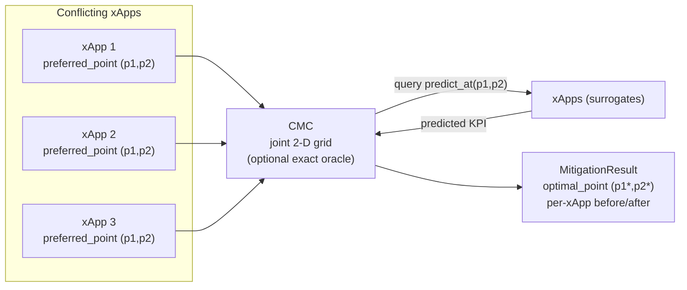

# Specification: CMC Joint 2-D Mitigation

**Track ID:** `cmc-2d_20261025`
**Status:** Draft
**Type:** Feature
**Scope:** Generalize the QACM Conflict Mitigation Controller (CMC) from a scalar `p1` sweep to a **joint `(p1, p2)` search**, add an exact brute-force solver as a test oracle, and make the xApp protocol dimension-aware — without breaking the existing 1-D CCO/ES flow.

**Related:** `thesis-proposal/plan/iteration-3/spec.md` §1.4, FR-4.6; QACM paper `2405.07324v2` §IV.

---

## 1. Overview

The completed `cmc-mvp_20261018` track resolves **scalar** conflicts over `p1`. Two limitations follow:

1. `BaseXApp.predict_at(p1)` pins `p2` to the **dataset minimum**, so the 2-D structure of the data (and any `p2`-mediated coupling) is never exercised.
2. `print_cmc_report` recomputes "before" KPI via `predict_at(preferred_p1)` at `p2_min`, which does not match the joint `(p1,p2)` KPI the xApp reported from `infer_action()`.

The QACM paper negotiates a scalar `p_l` per detected conflict (Algorithm 1, `O(N·|X'|)`). The thesis **iteration-3** deliberately extends QACM to **joint-parameter bargaining** over the control vector `p = [p_power, p_RBG]`, with an exact 2-D search for small ranges and a 2-D grid heuristic for large ones (FR-4.6). This track implements that extension in the surrogate testbed and uses it to demonstrate **direct** and **indirect** conflicts on the synthetic datasets added in `data/synthetic/`.

**Key design principle (modularity):** the CMC still depends only on the `IQueryableXApp` protocol. Dimension awareness comes from the protocol (`preferred_point`, `predict_at`), not from concrete xApp imports.

---

## 2. Functional Requirements

### FR-1: Dimension-aware `IQueryableXApp` protocol
- Replace the flat `preferred_value: float` requirement with `preferred_point: tuple[float, ...]`.
- Keep `preferred_value` as a deprecated read-only property on `BaseXApp` returning `preferred_point[0]`, so 1-D callers keep working.
- Extend the query method to `predict_at(p1: float, p2: float | None = None) -> float`. A 1-argument call must remain valid; when `p2` is omitted it defaults to the xApp's **preferred `p2`** (not the dataset minimum).

### FR-2: Joint 2-D `CMC`
- Constructor accepts either the legacy `range: tuple[float, float]` or `ranges: Sequence[tuple[float, float]]` (one `(lo, hi)` per ICP).
- `resolution` is per-axis (`int` or `Sequence[int]`, default `128`); the candidate set is the Cartesian product of per-axis `linspace` grids.
- `mitigate(xapps)` sweeps the joint grid and returns the point minimizing the unchanged QACM cost:
  `Σ_i w_i·d_i·ζ − (Σ_i s_i)^2`.
- Weight normalization (`Σ w_i = 1`), deviation direction (`max`/`min`), and satisfaction semantics are unchanged.
- `optimize_over: Sequence[int] | None` restricts the sweep to a subset of ICP indices (`None` = all). Non-optimized ICPs are held at **each xApp's own `preferred_point`** when queried.
- Deterministic tie-break: lowest cost, then lexicographically smallest point.

### FR-3: Exact solver as test oracle
- Add `exact_mitigate(xapps)` (or `CMC.exact_mitigate`) that brute-forces the full candidate set without heuristic shortcuts.
- On small instances the heuristic result must match the exact result (same optimal cost, point within tolerance).
- The exact solver is a **test/reference oracle**, not the production path.

### FR-4: Dimension-aware `MitigationResult`
- Canonical field `optimal_point: tuple[float, ...]`.
- Keep `optimal_value` as a deprecated property returning `optimal_point[0]`.
- `per_xapp` records include `preferred_point`, `predicted_at_preferred`, `predicted_at_optimum`, `qos_threshold`, `satisfied_before`, `satisfied_at_optimum` (existing keys retained).
- `n_satisfied_before` is computed at each xApp's `preferred_point`, so it agrees with `infer_action()["predicted_kpi"]`.

### FR-5: xApp adapter
- `BaseXApp.preferred_point` returns the full `infer_action()["requested_value"]` tuple.
- `BaseXApp.predict_at(p1, p2=None)` builds a full feature row; `p2=None` → `preferred_point[1]`.
- Guard rails: clear errors when the xApp is untrained or the requested point has the wrong arity.

### FR-6: Runner, report, and CLI
- `print_cmc_report(result, actions=None)` prints `p* = (p1, p2)` and every xApp's requested point.
- All xApps appear with real request values (no `nan` fallback for the 3rd+ xApp).
- `cli/cli.py` passes the full action list, gains `--optimize-over {joint,p1,p2}`, and treats `--cmc-resolution` as per-axis.

### FR-7: Synthetic conflict scenarios and tests
- Add pytest coverage that loads `data/synthetic/*.csv`, asserts the known peaks, and exercises:
  - a 2-app **direct** conflict (app1 vs app2),
  - a 3-app **direct + indirect** conflict where adding app3 shifts `p2*`,
  - priority weights moving the compromise,
  - threshold sweeps changing the satisfied count,
  - 2/3/4-app CLI runs with no `nan` values.

### FR-8: Documentation
- Update `docs/usage/RUNNING_CMC.md`, `docs/usage/CLI.md`, `docs/usage/SCENARIOS.md`, and `README.md`.
- State explicitly that joint 2-D bargaining is an **extension beyond the QACM paper** and why (iter-3 FR-4.6).

---

## 3. Non-Functional Requirements

- **NFR-1 Modularity:** the CMC imports no concrete xApp class; it depends only on `IQueryableXApp`.
- **NFR-2 Backward compatibility:** existing 1-D tests, the `surrogate-xapps` CLI demo, and `optimal_value`/`preferred_value` consumers keep working.
- **NFR-3 No data sharing:** the CMC queries only KPI predictions; it never reads xApp training data or internals.
- **NFR-4 Performance:** default `128` points per axis (16,384 points at 2-D). A full 4-xApp mitigation should complete within the 1 s scheduling budget on CPU; per-axis resolution remains configurable.
- **NFR-5 Determinism:** identical inputs produce identical `optimal_point` (fixed seeds, deterministic tie-break).
- **NFR-6 Testability & coverage:** >80% coverage on touched modules; analytic mocks provide an independent oracle.
- **NFR-7 Dependencies:** no new dependencies; pure numpy for the grid and exact solver.

---

## 4. Acceptance Criteria

- [ ] `IQueryableXApp` exposes `preferred_point` and `predict_at(p1, p2=None)`; existing 1-arg mocks still satisfy it.
- [ ] `CMC` accepts 1-D and 2-D ranges and returns an `optimal_point` of matching dimension.
- [ ] `predict_at(*x.preferred_point) ≈ x.infer_action()["predicted_kpi"]`.
- [ ] `exact_mitigate` and the grid heuristic agree on small analytic instances (same cost).
- [ ] A 2-app direct conflict and a 3-app indirect conflict are covered by automated tests, with `p2*` shifting when app3 is added.
- [ ] Priority weights demonstrably move the compromise toward the higher-weight xApp's preference.
- [ ] `print_cmc_report` shows real request values for every xApp (no `nan`).
- [ ] `uv run pytest` passes; coverage on touched modules >80%; existing 61 tests remain green.
- [ ] All new public classes/methods have numpydoc docstrings per `product-guidelines.md`.
- [ ] Docs distinguish paper behavior (scalar) from the implemented extension (joint 2-D).

---

## 5. Out of Scope

- Implicit conflicts (hidden parameter–KPI relationships not visible from the requested points).
- Continuous, MILP, or gradient-based solvers in the production path (the exact solver is a test oracle only).
- Real Near-RT-RIC / E2 deployment.
- CS (Conflict Supervision) priority-weight policy engine.
- NSWF/EG benchmark implementations (may be a follow-up track).
- Changes to the surrogate model families (poly/ANN remain as-is).
