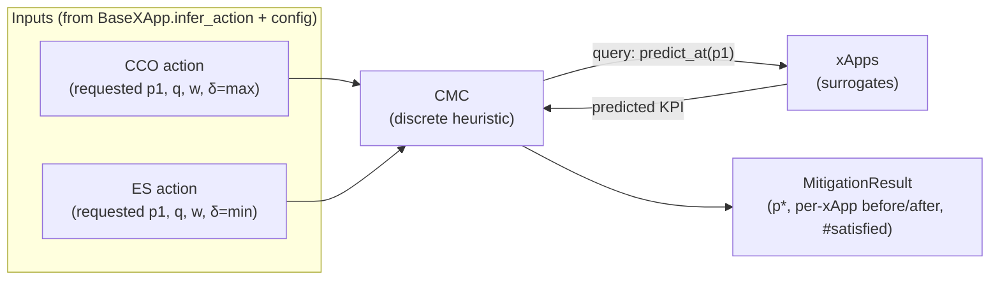

# Specification: QACM Conflict Mitigation Controller (CMC) MVP

**Track ID:** `cmc-mvp_20261018`
**Status:** Draft
**Type:** Feature
**Scope:** A modular Conflict Mitigation Controller (CMC) implementing the QACM discrete heuristic, resolving direct conflicts between the existing CCO/ES surrogate xApps (and future xApps) via QoS-aware compromise, with no data sharing between xApps.

---

## 1. Overview

The completed `surrogate-xapps` track produces two xApps that each independently request their own optimum over the shared ICP `p1`, producing a **direct conflict** (CCO wants `p1≈-47`, ES wants `p1≈-138`). The CMC resolves this by querying each xApp's predicted KPI at candidate `p1` values and selecting the compromise that **minimizes weighted QoS deviation while maximizing the number of satisfied xApps** (QACM Algorithm 1, `2405.07324v2`).

**Key design principle (modularity):** CMC only needs each xApp to answer *"if forced to use value p, what's my predicted KPI?"* — exposed via a small `IQueryableXApp` protocol (thin adapter on existing `predict_kpi`). Adding a 3rd/4th xApp requires no CMC changes.

---

## 2. Functional Requirements

### FR-1: `IQueryableXApp` protocol
- Define a structural protocol / ABC requiring `predict_at(p: float) -> float`: the predicted KPI if the xApp is forced to use the given `p1` value (with `p2` held at the xApp's observed constant).
- Add an adapter method on `BaseXApp` (or a subclass) implementing `predict_at` using the existing surrogate `predict_kpi`, so CCO and ES satisfy the protocol with no reimplementation.

### FR-2: `CMC` class (QACM discrete heuristic)
- Constructor takes: candidate range for the shared ICP, resolution (number of discrete points), and tuning constant `ζ` (default `1e3`).
- `mitigate(xapps: Sequence[IQueryableXApp]) -> MitigationResult`:
  1. For each candidate `p1` in the range (discrete grid):
     - For each xApp `i`: `U_i = xapp.predict_at(p1)`.
     - Compute deviation `d_i = max(0, q_i - U_i)` if `δ_i=max`, else `max(0, U_i - q_i)`.
     - Compute satisfaction `s_i = 1` if `U_i` meets `q_i` in the correct direction, else `0`.
     - Cost `= Σ w_i·d_i·ζ − (Σ s_i)²`.
  2. Return the `p1` minimizing cost.
- Weights `w_i` normalized to sum to 1 (per QACM constraint).
- Complexity `O(N·|X'|)`; pure numpy, no solver dependency.

### FR-3: `MitigationResult` dataclass
- Fields: `optimal_value` (p*), `per_xapp` (list of dicts: `xapp_id`, `predicted_at_optimum`, `qos_threshold`, `satisfied_at_optimum`, `satisfied_before`), `n_satisfied_before`, `n_satisfied_after`, `cost_trace` (optional: costs across candidates for plotting).
- Helper: `improved() -> bool` (n_satisfied_after ≥ n_satisfied_before).

### FR-4: QoS satisfaction logic reuse
- Satisfaction check must match `BaseXApp.qos_satisfied` semantics (max: `U≥q`; min: `U≤q`) — reuse or mirror it to avoid divergence.

### FR-5: Runner integration (demo)
- Extend the existing runner (or add a CMC runner entrypoint) to: train both xApps, detect the conflict, run `CMC.mitigate`, and print a **before/after** comparison table (each xApp's requested vs. compromised KPI, QoS met?, total #satisfied).
- Default demo: CCO + ES over `data/cmsORAN/data1.csv` & `data2.csv`, shared ICP `p1`, `p2` held at each xApp's constant (20 for CCO, 60 for ES).

### FR-6: Configuration
- Per-xApp QoS thresholds (`q_i`) and priority weights (`w_i`) sourced from existing `XAppConfig` (or passed explicitly). Provide sane defaults (equal weights 0.5/0.5 for the 2-xApp demo).

---

## 3. Non-Functional Requirements

- **NFR-1 Modularity:** CMC must not import or reference `CCOxApp`/`ESxApp` concretely — only the `IQueryableXApp` protocol. A new xApp plugs in by implementing `predict_at`.
- **NFR-2 Testability:** >80% coverage. Heuristic testable with a mock xApp (analytic KPI function) independent of real datasets.
- **NFR-3 Reproducibility:** deterministic given fixed surrogates (ANN `random_state=42` already set).
- **NFR-4 No data sharing:** CMC queries only KPI predictions, never xApp internals/training data.
- **NFR-5 Dependencies:** pure numpy for the heuristic (no new heavy deps beyond existing stack).

---

## 4. Acceptance Criteria

- [ ] `predict_at(p1)` exists on both CCO and ES and returns the surrogate-predicted KPI at that `p1`.
- [ ] `CMC.mitigate([cco, es])` returns a `MitigationResult` with a `p*` that lies between the two conflicting requests.
- [ ] On the default 2-xApp demo, `n_satisfied_after ≥ n_satisfied_before` (mitigation does not worsen QoS satisfaction).
- [ ] A unit test with a **mock** xApp (e.g. linear KPI functions with known thresholds) reproduces a hand-computed optimal `p*`.
- [ ] Weights are normalized to sum to 1.
- [ ] Adding a third mock xApp changes no CMC code (only the input list).
- [ ] `uv run pytest` passes with >80% coverage; `uv run` demo prints a clear before/after table.
- [ ] All new public classes/methods documented per `product-guidelines.md`.

---

## 5. Out of Scope

- Indirect and implicit conflict types (MVP targets direct conflicts over one shared ICP).
- Continuous optimization / MILP solver formulation (discrete heuristic only).
- Multi-ICP joint optimization (MVP resolves a single shared ICP `p1`; `p2` held constant).
- Real Near-RT-RIC / E2 deployment.
- Benchmarking against NSWF/EG (may be a follow-up track).
- CS (Conflict Supervision) xApp priority-weight policy engine.
