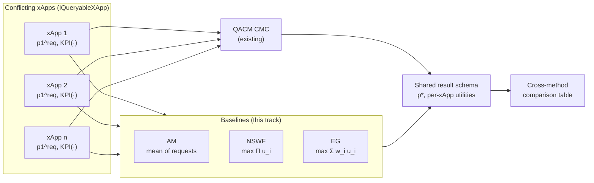

# Specification: Wadud Game-Theoretic Baseline (AM / NSWF / EG)

**Track ID:** `wadud-baseline_20261101`
**Status:** Baseline implementation complete; faithful paper-data adapter pending review
**Type:** Benchmark / Evaluation
**Scope:** Implement the arithmetic-mean (AM), Nash Social Welfare (NSWF) and Eisenberg-Gale (EG) conflict-mitigation baselines from Wadud, Golpayegani & Afraz (`2311.13389v1`, 2023) against the existing `IQueryableXApp` protocol, and evaluate them head-to-head with the current QACM CMC on faithful paper-derived scenarios and synthetic scenarios.

**Related:**
- Baseline paper: `2311.13389v1` — http://arxiv.org/abs/2311.13389
- Successor / current implementation: QACM `2405.07324v2` — http://arxiv.org/abs/2405.07324
- Thesis requirements: `thesis-proposal/plan/iteration-3/spec.md` FR-6.2 (NSWF), FR-6.3 (EG), FR-8.2 (QoS satisfaction/shortfall), FR-8.4 (latency), acceptance criterion 4
- Prior tracks: `cmc-mvp_20261018` (scalar CMC), `cmc-2d_20261025` (joint 2-D CMC)

---

## 1. Overview

`2311.13389v1` is the direct precursor of QACM and the baseline QACM itself benchmarks against. It resolves conflicts by maximising a **collective utility** over a shared Input Control Parameter (ICP) using cooperative game theory, with three methods:

| Method | Objective | Weights | QoS-aware |
|---|---|---|---|
| AM (arithmetic mean) | `x* = mean_i(p_i^req)` | no | no |
| NSWF (Nash Social Welfare) | `x* = argmax_x Π_i u_i(x)` | no | no |
| EG (Eisenberg-Gale) | `x* = argmax_x Σ_i w_i·u_i(x)` | yes (`Σw_i = 1`) | no |

This makes it the highest-fidelity external comparison available for our testbed:

1. **Same experimental substrate.** Polynomial regression blocks trained on synthetic Gaussian KPI surfaces, a single shared ICP, 3–4 xApps, and per-conflict MNO priority weights — all things our testbed already models.
2. **Same unit of comparison.** Both methods return one parameter value and the resulting per-xApp utilities. No simulator, no training loop, and no reward signal is required.
3. **It isolates the thesis claim.** NSWF/EG are *QoS-blind*: they can leave an xApp below its threshold while the aggregate looks good. Running them on identical data is the cleanest way to demonstrate that the QACM satisfaction term (`− (Σ s_i)²`) is what changes the outcome, not the surrogate or the data.
4. **The gap is small.** All three baselines are selectors over the candidate grid the CMC already builds. No production CMC logic changes are required (Principle 2: modularity).

---

## 2. What is reproduced, what is not

| Paper element | Decision | Note |
|---|---|---|
| Utility normalisation (min–max × 10) | **Reproduce** | §4.1; needed for comparable utility numbers |
| AM baseline | **Reproduce** | Present in the paper's results table |
| NSWF (non-priority) | **Reproduce** | Eq. in §4 |
| EG (priority, weighted linear program) | **Reproduce** | Eq. in §4; weights supplied per scenario |
| Direct / indirect / implicit conflict scenarios | **Reproduce** | §5 results table |
| CMS architecture (Ch1/Ch2, SDL, RCP/PGD/PKR/… tables) | **Out of scope** | Deployment architecture, not needed to compare mitigation quality |
| CDC conflict classification rules | **Out of scope** | Our scenarios declare their conflict type explicitly |
| 8-ICP / 6-KPI experimental model | **Planned faithful adapter** | Sweep only shared `p1`; hold every other ICP at the paper's declared fixed value. Full-dimensional generated data is preferred over silently dropping columns |
| MNO weight assignment policy | **Out of scope** | Weights are scenario inputs, not learned |

---

## 3. Functional Requirements

### FR-1: Utility normalisation (`surrogate_xapps/utility.py`)
- Implement the paper's per-KPI min–max scaling onto `[0, 10]`:
  `u_i(x) = (1/|J_i|) · Σ_j ( (o_ij(x) − o_ij^min) / (o_ij^max − o_ij^min) ) × 10`.
- For `objective="min"` xApps (ES / power), invert the numerator so higher utility still means better:
  `(o_ij^max − o_ij(x)) / (o_ij^max − o_ij^min)`. This is a **documented deviation**: the printed formula assumes higher-is-better.
- Expose `mode="minmax10"` (default, faithful) and `mode="zscore"` (matches the `normalisedKPI` column shipped with `data/QACM/*.csv`, FR-4.5 of the thesis proposal). `mode` must be an explicit argument, never inferred.
- Normalisation bounds come from the *candidate grid*, not the training set, and the chosen bounds must be returned in the result so the number is reproducible.
- Handle `o_max == o_min` (constant KPI) by returning `0.0` and emitting a warning rather than dividing by zero.

### FR-2: Baseline mitigation methods
- Add `surrogate_xapps/baselines.py` exposing a common `MitigationPolicy` protocol with `mitigate(xapps, ranges, resolution, weights=None) -> MitigationResult`, reusing the existing `MitigationResult` dataclass so `print_cmc_report` works unchanged.
- `ArithmeticMeanPolicy`: returns the arithmetic mean of `preferred_point`, projected into the search box; ignores KPI predictions entirely (this is the paper's naive baseline).
- `NSWFPolicy`: returns `argmax_x Π_i u_i(x)`.
  - Computed as `argmax_x Σ_i log(max(u_i(x), ε))` for numerical stability. This is an implementation detail, not a mathematical deviation; document it.
  - `ε` and the behaviour when any utility is zero must be explicit (`zero_policy ∈ {"clamp", "literal"}`). Under `"clamp"` the policy logs how many candidates had a zero factor.
- `EisenbergGalePolicy`: returns `argmax_x Σ_i w_i·u_i(x)` with weights normalised to sum to 1; raises on all-zero or non-finite weights.
- All three policies respect `optimize_over` (scalar comparison uses `[0]` / the `p1` axis) and the deterministic tie-break rule already used by the CMC (lowest objective, then lexicographically smallest point).
- Policies must **not** read xApp training data or internals — only `preferred_point`, `predict_at`, `objective`, and metadata (NFR-3 of the CMC track).

### FR-3: Data and scenario adapter
- Add a scenario registry (e.g. `surrogate_xapps/scenarios.py` or `scenarios/wadud.py`) defining S1–S9 from §5 with: dataset paths, xApp names/objectives, shared ICP, fixed non-conflicting ICP values, weights, and expected published outcome where one exists.
- Paper datasets are the CSVs in `data/QACM/` (`data1`–`data5`). Note their shapes: `data2` and `data5` have three input columns; `data4` has four input columns and two outputs. The approved implementation path is to add `scripts/gen_wadud_datasets.py` (fixed `random_state=42`) that regenerates full-dimensional Gaussian surfaces with the paper's documented ranges, while reusing the existing `DatasetSpec`/`load_dataset` contract.
- The scenario adapter must expose the shared `p1` as the only optimized axis and pass the paper's fixed values for every non-shared ICP during prediction. Setting an unused feature to zero is not an accepted substitute unless zero is the declared paper value.
- Phase 1 must record the confirmed xApp → dataset/column mapping in `docs/usage/BASELINES.md`; no mapping may be assumed silently.

### FR-4: Result schema and reporting
- Reuse `MitigationResult` for `optimal_point`, `per_xapp`, `n_satisfied_before`, `n_satisfied_after`.
- Add an evaluation record per `(scenario, method)` carrying every metric in §4. Reporting must be machine-readable (list of dicts / CSV) so tables in the thesis are generated, not hand-copied.
- `print_cmc_report` must render non-QACM rows without special-casing; any method-specific footer (e.g. "NSWF objective = …") is additive.

### FR-5: CLI and evaluation harness
- Extend `cli/cli.py` with `--method {qacm,am,nswf,eg}` (default `qacm`, preserving current behaviour).
- Add `--weights` reuse (already exists) and `--utility-mode {minmax10,zscore}`.
- Add a harness entry point (e.g. `python -m surrogate_xapps.evaluate --scenario S1 --methods all`) that runs the full matrix and writes `results/*.csv` plus a Markdown table.
- Every method must run under identical data, resolution, seeds and thresholds in a single invocation.

### FR-6: Tests
- Unit tests for the utility normaliser: hand-computed values, `min`-objective inversion, constant-KPI guard.
- Property tests: NSWF is invariant to a positive rescaling of any `u_i` and to weights; EG moves monotonically toward the higher-weighted xApp; AM is prediction-free and equals `mean(preferred_point)`.
- Scenario tests on S1–S4 asserting either reproduction of the published `p*` (within tolerance) **or** an explicit, asserted discrepancy with a recorded reason.
- A regression test proving QACM satisfies ≥ as many xApps as NSWF/EG on S1–S4 (acceptance criterion 4 of the thesis proposal). If this fails, the test must fail loudly — do not weaken it.

---

## 4. Metrics compared

Every `(scenario, method)` row reports all of the following. Symbols follow the paper where possible.

| # | Metric | Definition | Source | Role |
|---|---|---|---|---|
| M1 | `p*` | Selected shared ICP value | `2311.13389v1` §5 | Primary outcome; compared to the published value |
| M2 | `u_i(p*)` | Per-xApp utility at `p*`, on `[0, 10]` | `2311.13389v1` §4 | Primary outcome; compared to published utilities |
| M3 | `u_i(p_i^req)` | Utility at that xApp's own requested value | derived | Reference ceiling per xApp |
| M4 | `Δu_i = u_i(p_i^req) − u_i(p*)` | Per-xApp utility loss (regret) | derived | Shows who pays for the compromise |
| M5 | `W(p*) = Σ_i w_i·u_i(p*)` | EG objective (weighted welfare) | `2311.13389v1` §4 | Cross-method welfare comparison |
| M6 | `N(p*) = Π_i u_i(p*)` | NSWF objective (Nash product) | `2311.13389v1` §4 | Cross-method fairness/efficiency comparison |
| M7 | `min_i u_i(p*)` | Worst-off xApp utility | derived | Fairness floor; exposes NSWF collapse |
| M8 | `max_i u_i − min_i u_i` | Utility spread | derived | Inequality across xApps |
| M9 | `n_satisfied / n_xapp` | Count at QACM QoS thresholds (`s_i`) | `2405.07324v2` (extension) | **Headline claim:** QACM ≥ baselines |
| M10 | `Σ_i w_i·d_i·ζ` | Weighted QoS deviation term | `2405.07324v2` | Explains *why* M9 differs |
| M11 | `dist(p*, p_i^req)` | Per-xApp concession distance (`abs(p* − p_i^req)`) | derived | Geometric interpretation of the compromise |
| M12 | `latency_ms` | Median wall-clock decision time | thesis FR-8.4 | Grid build + `n_xapp · N` surrogate queries |
| M13 | `deterministic` | Identical `p*` across repeated runs | NFR-5 | Reproducibility gate |

Reporting rules:
- M1–M4 are the **paper-fidelity** metrics; M9–M10 are the **thesis-claim** metrics. Never present M9 alone without M2, or NSWF/EG look artificially bad.
- Latency excludes surrogate training but includes grid construction and all queries, so it is comparable to the CMC numbers in `docs/usage/RUNNING_CMC.md`.
- Published values from `2311.13389v1` are reference points, not targets: a mismatch is acceptable **only** if recorded with the reason (data provenance, utility mode, or range mismatch).

---

## 5. Scenarios under test

Fixed ICPs follow the paper (§5): `p2 = 20`, `p3 = 60`, `p4 ∈ [-100, 100]`, `p5 = 60`, `p6 ∈ [-50, 150]`, `p7 = 60`. The shared ICP is `p1 ∈ [-150, 150]`.

| ID | Scenario | xApps (paper) | Shared ICP | Weights | Published reference (`2311.13389v1` §5) | Purpose |
|---|---|---|---|---|---|---|
| S1 | **Direct, non-priority** | xApp1 (MLB) −50 vs xApp2 (CCO) +50 | `p1` | `{0.5, 0.5}` | AM → 0 (`u1≈0.02`, `u2≈0.72`); NSWF → −18 | Fidelity: does our NSWF land near −18? |
| S2 | **Direct, priority** | same pair | `p1` | `{0.4, 0.6}` | EG → 22 (favours xApp2) | Fidelity: EG weight direction |
| S3 | **Indirect** | xApp2 (CCO) vs xApp4 (MRO); x2 sets `p1=0`, x4 utility collapses | `p1` | `{0.1, 0.9}` | AM → 12 (no improvement); NSWF → 66; EG → 110 | Fidelity: coupling recovery |
| S4 | **Implicit** | xApp1 (MLB) vs xApp3 (ES); x1 sets `p1=−85`, x3 falls below 0.4 | `p1` | `{0.9, 0.1}` | AM → −84 (no improvement); NSWF → −62; EG → −75 | Fidelity: hidden KPI interaction |
| S5 | **Four-way scaling** | xApp1–xApp4 | `p1` | `{0.1, 0.2, 0.3, 0.4}` | none published | Scalability; NSWF product underflow; EG weight sensitivity |
| S6 | **Synthetic direct pair** | `data/synthetic/xapp1_direct`, `xapp2_direct` | `p1` only | `{0.5, 0.5}` | n/a | Out-of-sample check (not tuned to the paper data) |
| S7 | **Synthetic indirect trio** | `data/synthetic/xapp1..3` | `p1` only | `{0.4, 0.4, 0.2}` | n/a | Out-of-sample coupling; does app3 still shift `p1*`? |
| S8 | **Weight sweep** | S1 pair, `w_x2 ∈ {0.0, 0.1, …, 1.0}` | `p1` | swept | n/a | Property test: NSWF invariant, EG monotone |
| S9 | **Edge cases** | constant-KPI xApp; zero-utility xApp; single xApp; all-equal utilities; all-zero weights | `p1` | various | n/a | Robustness: NSWF collapse, EG undefined weights |

Scenario notes:
- S1–S5 use the paper's data (`data/QACM/`, or regenerated Wadud surfaces — see FR-3). S6–S7 deliberately use data the baselines were never designed around.
- All scenarios run in **scalar mode** (`optimize_over=[0]`). Joint 2-D is an extension of QACM (iter-3 FR-4.6) and is *not* part of this comparison; if a joint row is shown it must be labelled "extension".
- Reproduction tolerance: `|p* − p*_published| ≤ 5` ICP units, and `|u_i − u_i,published| ≤ 1.0`. Values outside tolerance must be recorded in the results CSV with a `discrepancy_reason` column.

---

## 6. Non-Functional Requirements

- **NFR-1 Modularity:** baselines live in their own module and depend only on `IQueryableXApp` + `MitigationResult`. No edits to `CMC` internals; no imports from `cli/` or `tests/`.
- **NFR-2 Backward compatibility:** `--method` defaults to `qacm`; every existing test, CLI invocation and `print_cmc_report` output stays valid.
- **NFR-3 Reproducibility:** fixed seeds, versioned scenario registry, results written to CSV with the git SHA of the run.
- **NFR-4 Performance:** each scenario must complete well inside the 1 s Near-RT-RIC budget at the default resolution; the harness reports M12.
- **NFR-5 Determinism:** identical inputs → identical `p*` (deterministic tie-break).
- **NFR-6 Testability:** >80% coverage on `utility.py`, `baselines.py`, `scenarios.py`; property tests independent of the paper's data.
- **NFR-7 Dependencies:** no new third-party dependencies (numpy only; `scipy` is **not** required for EG since the objective is a linear scan over the grid).
- **NFR-8 Research fidelity:** every departure from `2311.13389v1` is documented in the module docstring and in `docs/usage/BASELINES.md`.

---

## 7. Acceptance Criteria

- [ ] `utility.py` implements min–max ×10 with `min`-objective inversion and a constant-KPI guard; hand-computed unit tests pass.
- [ ] `AM`, `NSWF`, `EG` policies each return a `MitigationResult` and work with 2, 3 and 4 xApps without touching `CMC`.
- [ ] NSWF is invariant to positive utility rescaling and to weights (property test).
- [ ] EG moves monotonically toward the higher-weighted xApp as its weight increases (S8).
- [ ] S1–S4 reproduce the published `p*` within tolerance, **or** record a documented discrepancy with a reason.
- [ ] QACM satisfies at least as many xApps as NSWF/EG on S1–S4 (`n_satisfied_after`), and strictly more on at least one scenario.
- [ ] The full `scenario × method` matrix runs in one command and writes a CSV with every metric M1–M13.
- [ ] Latency for every method is reported and within the 1 s budget.
- [ ] `--method` defaults to `qacm`; the full suite stays green; coverage on new modules >80%.
- [ ] Docs state the paper-vs-extension boundary and the `min`-objective inversion deviation.

---

## 8. Out of Scope

- The CMS deployment architecture (Ch1/Ch2 messaging, SDL tables, PMon/CDC controllers).
- Conflict *detection* or classification (CDC rules); scenarios declare their type.
- Joint `(p1, p2)` evaluation for the baselines (scalar only; joint 2-D remains a QACM extension).
- COMIX, twin-fidelity, CMF and PACIFISTA baselines (separate comparison tracks).
- Any RL method (team learning, distillation, scheduler, MARL).
- A learned or policy-driven weight assignment (the CS xApp is future work).
- Real Near-RT-RIC / E2 / ns-O-RAN deployment.

---

## 9. Deviations and open questions

| ID | Item | Resolution |
|---|---|---|
| D1 | `min`-objective utility inversion | Not in the printed formula; required for ES. Documented as a deviation (FR-1). |
| D2 | NSWF computed in log-space with `ε` clamp | Numerical detail; both `zero_policy` modes available so the literal product can be reproduced. |
| D3 | EG solved by grid scan, not a convex program | The paper treats EG as a constrained LP. On a discrete ICP grid the weighted sum is a linear scan, so the optimum is identical; document that no solver is used. |
| Q1 | Which `data/QACM/data*.csv` maps to which xApp | Phase 1 provenance audit; must not be assumed. |
| Q2 | Whether the shipped CSVs cover `p1 ∈ [-150, 150]` | If not, regenerate via `scripts/gen_wadud_datasets.py`; the existing files are QACM's datasets, not necessarily Wadud's. |
| Q3 | Utility bounds (`o_min`, `o_max`) | Use grid-derived bounds by default; record them per run. |
| Q4 | Handling zero-utility candidates in NSWF | Default `clamp` + warning; `literal` available for fidelity. |
