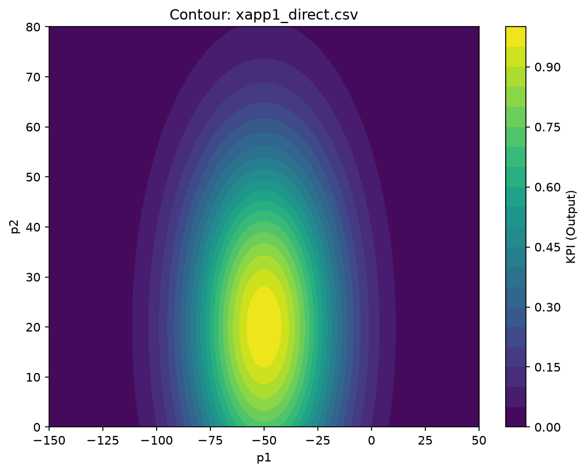
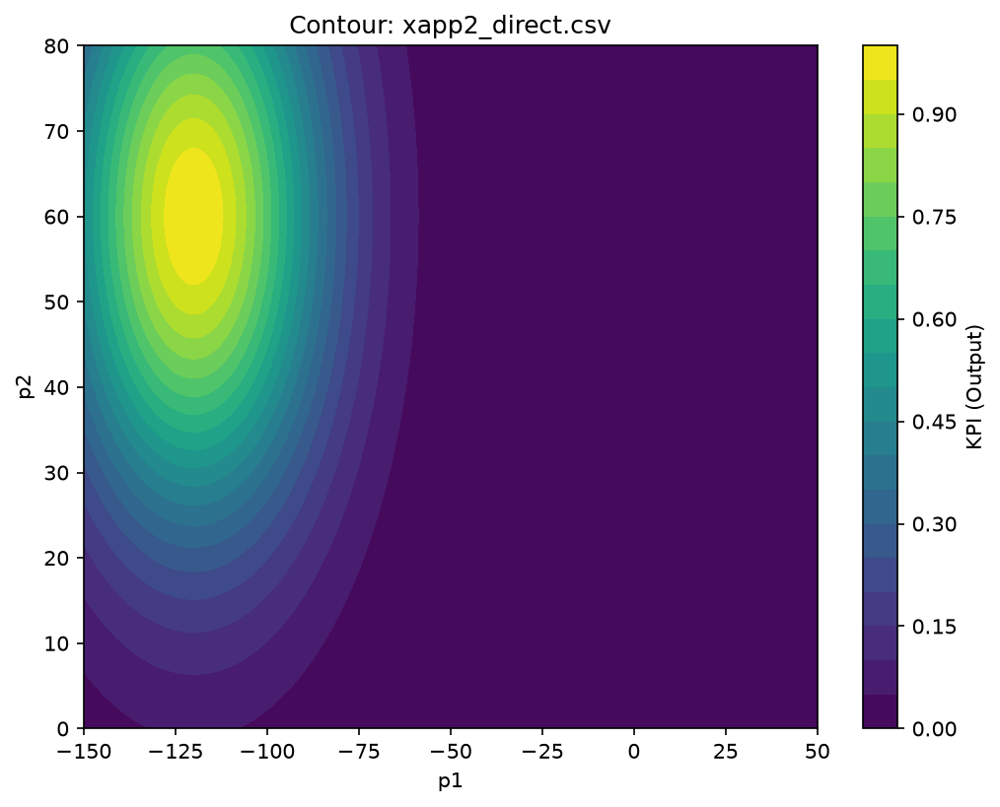
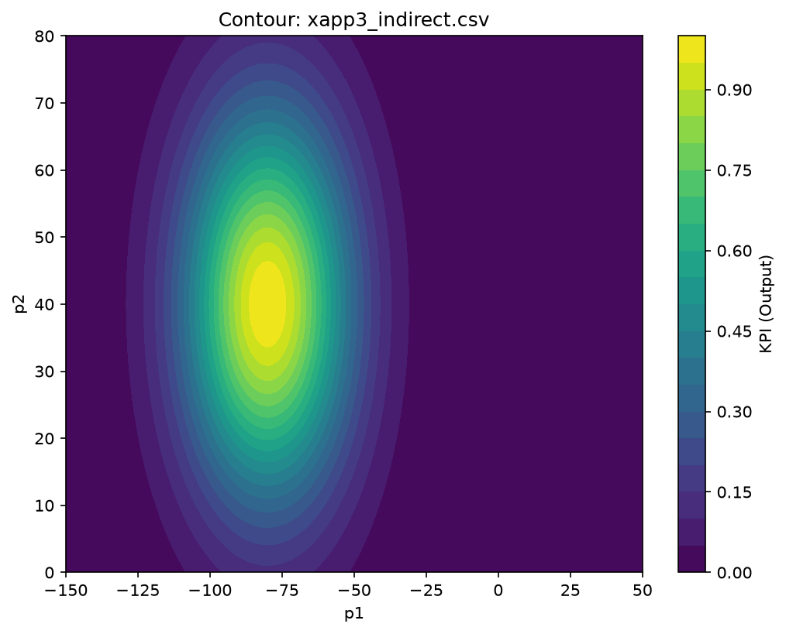
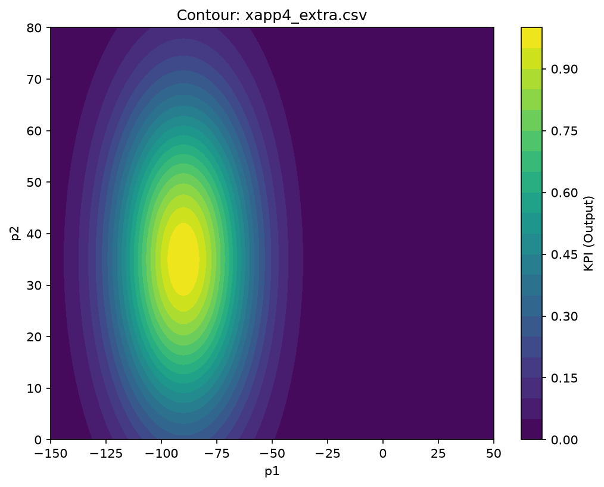

# Synthetic 2D Datasets for Direct + Indirect Conflict

Generated by `scripts/gen_synthetic_2d.py` (seed=42). All files follow the cmsORAN layout: `Input1,Input2,Output`.

## Files

| File | Peak (p1c,p2c) | Sigma | A | Objective | Purpose |
|---|---|---|---|---|---|
| `xapp1_direct.csv` | (-50, 20) | 25 | 1.0 | max | Direct party (CCO-like) |
| `xapp2_direct.csv` | (-120, 60) | 25 | 1.0 | max | Opposing direct party (creates direct conflict with x1) |
| `xapp3_indirect.csv` | (-80, 40) | 20 | 1.0 | max | Indirect/coupled to p2 (strong p2 dependence) |
| `xapp4_extra.csv` | (-90, 35) | 22 | 1.0 | max | Extra coupling (implicit-like mix) |

- Range: `p1 ∈ [-150,50]`, `p2 ∈ [0,80]` (141×81 grid)
- `synthetic_meta.json` contains full metadata

## Visualizations

## Notes on conflicts

- **Direct conflict**: x1 wants (p1,p2) near (-50,20); x2 wants near (-120,60). Their requested optima differ on both ICPs.
- **Indirect conflict**: x3 peaks at (-80,40) (middle p2). When CMC resolves the direct pair (x1,x2), moving p2 toward the middle degrades x3's KPI relative to its own peak — this is the indirect coupling effect (Case C style).
- **Direct+Indirect**: running CMC on [x1,x2,x3] produces a compromise that trades off satisfaction across all three (often preserves total count or redistributes). Comparing to [x1,x2] alone shows the indirect coupling shifts the optimum.
